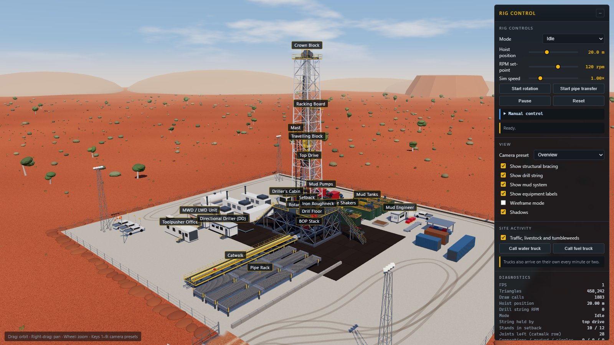
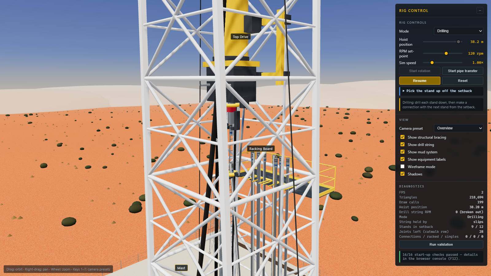
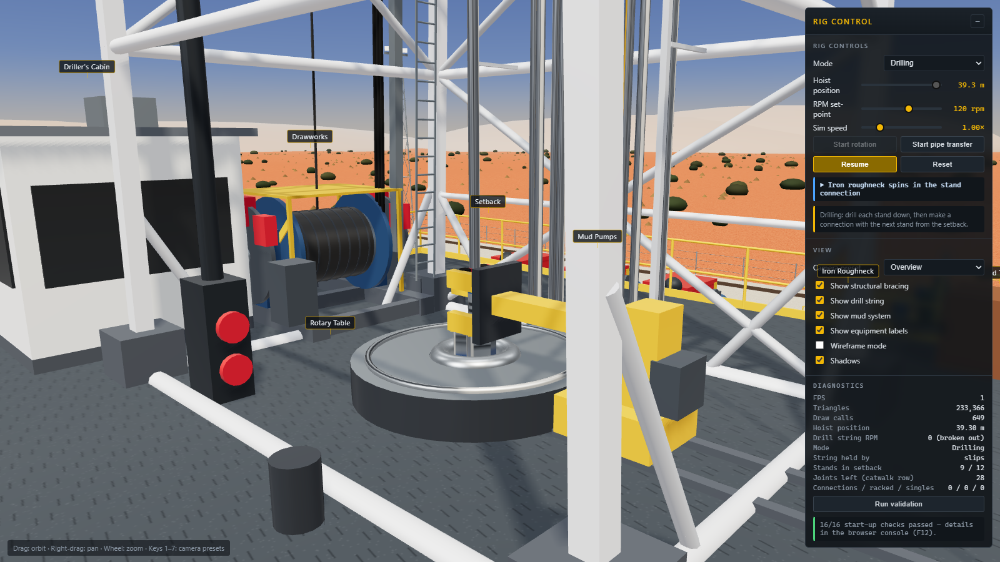
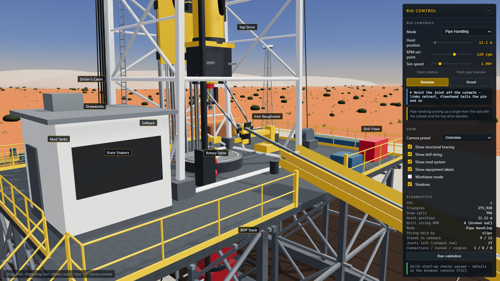
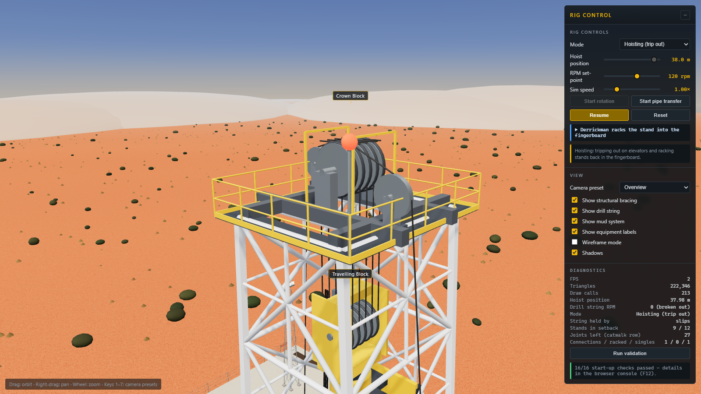
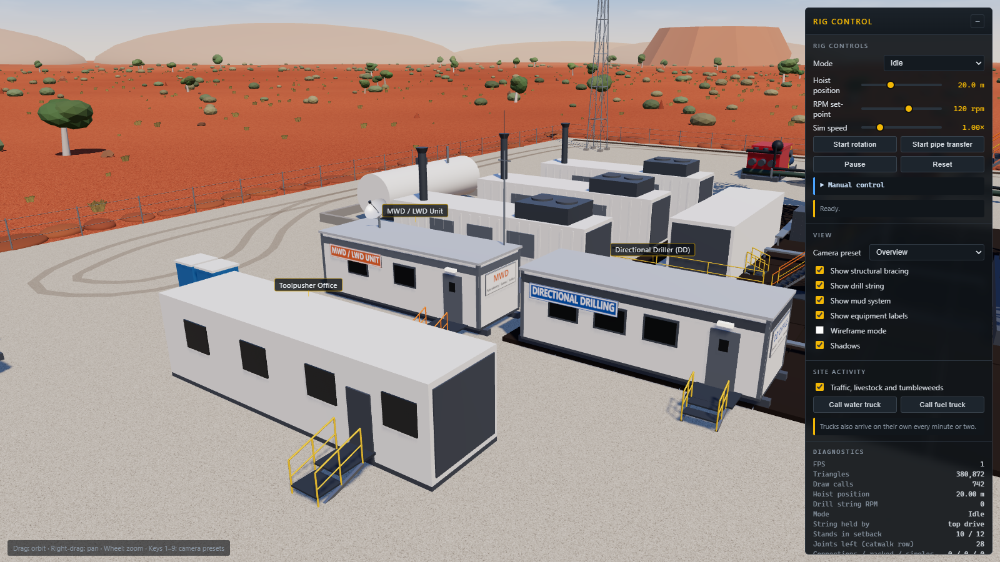
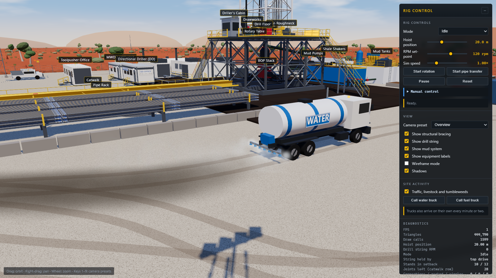
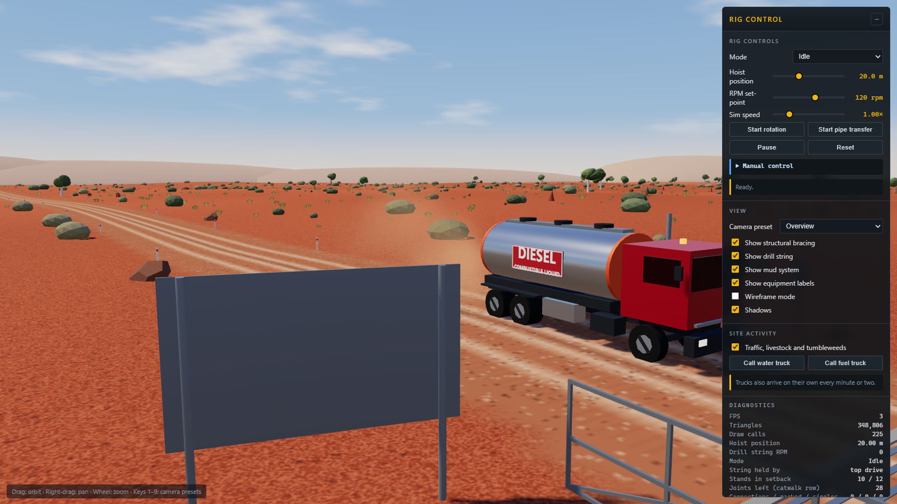
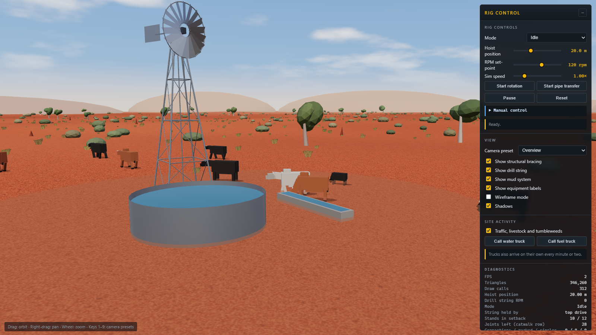

# Onshore Top-Drive Drilling Rig — Procedural Three.js Visualisation

An interactive, browser-based 3D model of a modern 1,500–2,000 hp AC triple land rig drilling a
directional well on a remote Australian wellsite. Every part of the site is generated procedurally
from Three.js geometry; there are no external model assets. The rig's operations (drilling
connections, tripping, picking up pipe) are driven by a step-by-step simulation of standard
top-drive rig procedures, and those procedures are dry-run and checked against mechanical rules
at start-up. Around the rig the site is alive: third-party service cabins (directional driller,
MWD/LWD, mud engineer), water and fuel trucks on the access road, cattle, horses, kites and
tumbleweeds.



| | |
|---|---|
|  |  |
|  |  |
|  |  |
|  |  |

---

## 1. Running it

```bash
npm install
npm run dev        # Vite dev server -> http://localhost:5173
npm run build      # production bundle in dist/
npm run preview    # serve the production bundle
npm run check      # headless procedure checks (no browser); add -- --steps to list every step
npm run smoke      # headless build of the whole site, 12 simulated minutes of site life, all 18 checks
```

Requires Node 18+ and a WebGL2 browser. Built against three r170 and Vite 6.

## 2. Architecture

The code is split into a **pure simulation** (no meshes, runs in Node) and a **view** that renders it.

| Layer | Files | Responsibility |
|---|---|---|
| Layout | `src/layout.js` | Single source of truth for dimensions, elevations, limits and positions |
| Simulation state | `src/sim/rigState.js` | Rig state (hoist, link tilt, elevator, slips, string, handled tubulars, catwalk, roughneck, setback slots), derived kinematics (elevator point, link-tilt clearance, trough pose, pick-up geometry) |
| Procedures | `src/sim/sequences.js` | Operating procedures as generator programs of timed steps: drilling + connection, trip out, single pick-up |
| Sequencer | `src/sim/sequencer.js` | Runs a program step by step; stops only at safe points; headless `simulate()` |
| Procedure checks | `src/sim/checks.js` | Per-tick mechanical rules and full dry runs of every procedure |
| Animator | `src/animations.js` | Owns state + sequencer, mode changes, manual control, pushes state into the scene each frame |
| Rig views | `src/rig/*.js` | `mast`, `substructure`, `topDrive` (block, top drive, links, elevator, drilling line), `drillString`, `floorEquipment` (slips, iron roughneck, setback stands), `drawworks`, `pipeHandling` (racks, catwalk, transfer joint), `mudSystem`, `wellControl`, `auxiliary`, `thirdParty` (DD office, MWD/LWD unit, mud engineer lab, utes, windsock, signage) |
| Site | `src/site/*.js` | `terrain` (ground height, road centreline, wind), `vehicles` (truck models, routes, traffic controller, dust, spray, wet ground), `wildlife` (cattle, horses, kites, tumbleweeds), `particles`, `signs` |
| Rendering | `src/scene.js`, `src/materials.js`, `src/environment.js`, `src/geometry.js` | Renderer, lights, procedural sky with drifting clouds (also baked into the image-based lighting), terrain, road, vegetation, stock bore, PBR materials and procedural textures, geometry helpers |
| UI / labels / checks | `src/ui.js`, `src/labels.js`, `src/validation.js` | Control panel, CSS2D labels, 18 spatial + procedural checks |

## 3. World layout

Y-up, metres. **Well centre = (0, 0, 0); the wellbore axis is X = 0, Z = 0.**

| Direction | Contents |
|---|---|
| +X | Iron roughneck track, pipe racks (X 3.8 → 15.2), deadline anchor, choke manifold, tool storage, truck lane, gate and access road (X 24) |
| −X | Drawworks, driller's cabin, standpipe, VFD house, generators, fuel tank, toolpusher office, **DD office (−18.5, 15)** and **MWD/LWD unit (−29.5, 15)** |
| +Z (front) | V-door and hydraulic catwalk (Z 6.5 → 38.8) |
| −Z (rear) | Setback and fingerboard (behind well centre, between the guide rails), flowline, shakers, mud tanks, mud pumps, **mud engineer lab (14.5, −27)** |
| Off the pad | Access road north of the gate (cattle grid, entry board), stock bore with windmill to the north-west (cattle), horse paddock to the east |

Key elevations: drill floor 8.0 · rotary 8.45 · string in slips: tool joint 0.7 m above the rotary ·
racking board 35 · water table / crown base 48 · crown sheaves ≈ 49.3 · hoist travel 9.35 → 39.8 m
(block top stays 0.5 m under the water table) · stands 3 × 9.5 = 28.5 m.

## 4. Operating procedures (logic checked against standard top-drive land-rig practice)

**Drilling mode: drill a stand down, then make a connection.**
1. Drill ahead: rotating, circulating, links in the drill-down tilt so the elevator clears the floor.
2. Drilled down: stop rotation, pick up off bottom to connection height, stop the pumps.
3. Set power slips; break out the saver sub (pipe-handler backup grips, quill turns left).
4. Hoist the empty elevator to the racking board, links tilting back toward the fingerboard.
5. Derrickman pulls the next stand out of the fingerboard into the elevator; elevator latches below the box tool joint.
6. Link tilt brings the stand top to well centre; pick the stand up off the setback; floor crew guides the pin over the stump.
7. Stab, then the iron roughneck travels in, spins in and torques the connection, and parks.
8. Top drive comes down (the elevator slides down the pipe), stabs the saver sub and makes it up.
9. Open the elevator and tilt links to drill-down; pick up and pull slips; start pumps; start rotation; tag bottom; drill ahead.

**Hoisting mode: trip out of the hole on elevators, racking back.** Set slips and break out the
top drive, latch the elevator below the stump tool joint, pull slips, pull one stand, set slips
under the next connection, the iron roughneck breaks out and spins out, the crew walks the pin to
the setback, set it down, link tilt and the derrickman rack the top into the fingerboard, lower
the empty elevator, repeat until the setback is full.

**Pipe-handling mode: pick up a single from the rack.** Set slips and break out, kickers roll a
joint into the catwalk trough, the catwalk lifts its rig end and runs forward so the trough reaches
over the V-door, the skate presents the box end to the drill floor, the top drive (links tilted
50°) latches the elevator below the box, hoists while the links retract and the pin end tails up
the trough and over the floor, the joint hangs plumb, the catwalk lowers, stab, iron roughneck
make-up, top-drive make-up, pull slips. The string is now one joint longer.

Setback slots are worked front row first (racking back fills the back row first) so a stand is
never dragged through the stands still in the fingerboard. Mode changes requested mid-operation
wait for the next safe point (string made up, or string in the slips with an empty elevator).

## 5. Controls

| Control | Effect |
|---|---|
| Left-drag / right-drag / wheel | Orbit / pan / zoom |
| Keys `1`–`9` or *Camera preset* | Overview, Front, Side, Top, Drill Floor, Pipe Handling, Mud System, Service Cabins, Gate & Access Road |
| *Mode* | Idle (manual), Drilling, Hoisting (trip out), Pipe Handling |
| *Hoist position* | Manual hoist target, Idle only (string made up: 9.35–39.8 m) |
| *RPM set-point* | 0–200 rpm used when drilling or rotating manually |
| *Sim speed* / *Pause* | 0.25×–4× simulation time, freeze |
| *Start/Stop rotation* | Idle only; refused when the string is in the slips or broken out |
| *Start pipe transfer* | Runs Pipe Handling; refused while rotating manually |
| *Reset* | String made up off bottom, setback and rack restocked |
| *Run validation* | Re-runs all checks; results in the browser console |
| *Traffic, livestock and tumbleweeds* | Turns the ambient site life on or off |
| *Call water truck* / *Call fuel truck* | Sends that truck in now (one truck on site at a time) |

## 6. Validation (runs at start-up; 18 checks)

Spatial checks on the scene: well-centre alignment; crown above block at max hoist; block above
top drive; top drive and drill-down elevator above the rotary/deck at min hoist; floor ≈ 8 m;
mast ≈ 48 m with the crown on the water table; racks +X; drawworks −X; tanks −Z; string rotates
about world Y without orbiting; hoist travel clamped; fast line and deadline clear the mast faces.

Procedure checks (headless dry runs, rules applied every 1/30 s tick): string always supported
(made up, in slips or latched); pumps only with the top drive made up; no rotation in the slips or
during pipe transfer; elevator never below the rotary clearance; saver sub never driven into a
tubular; anything latched sits exactly in the elevator; no tubular through the deck, the stump or a
racked stand; no tubular jumps between ticks; catwalk trough above deck height inside the floor
footprint. Runs: one drilling connection, one trip-out stand, one single pick-up, and a full cycle
(drill until the setback is empty, then trip out until it is full).

Site checks: the three third-party cabins sit on the pad and do not overlap any other equipment;
both truck routes are swept against every mesh on the pad and must keep more than 0.3 m clear
(currently 1.9 m for the water truck and 1.6 m for the fuel truck).

## 7. Site life

- **Third-party services.** Directional driller office and MWD/LWD unit (satellite dish, radio mast,
  tool rack, cable tray toward the rig) on the driller's side; mud engineer lab with test bench and
  sack pallets beside the mud tanks. Each has its own label and signage.
- **Water truck.** Comes in through the gate, loops the east side of the pad with the spray bar on,
  and drives back out. The wet ground it leaves darkens the gravel and dries out over about 80 s;
  wheel dust is suppressed on wet ground.
- **Fuel truck.** Drives round the rear of the pad to the fuel tank bund, connects a hose and unloads
  for 16 s, turns in the yard and leaves the way it came.
- **Timing.** The first water truck arrives a few seconds after loading; after that a truck arrives
  every 45–120 s, alternating fuel and water. Vehicles keep left and slow for corners and the gate.
- **Livestock.** Eleven cattle around the stock bore (windmill, tank, trough) and four horses in the
  east paddock graze, look around, wander, and occasionally move off as a mob (the horses canter).
  Paddocks are fenced off in logic: animals never enter the pad or the road corridor.
- **Wind.** One wind direction drives the windsock, windmill, cloud drift, dust and the tumbleweeds,
  which roll through every 5–20 s on lines that pass either side of the pad.

## 8. Known limitations

- Animation time is accelerated (drilling 0.8 m/s); the drawworks drum turns at a quarter of its true 10-line speed so it reads at 60 fps.
- Thread make-up advance (≈0.1 m) is not modelled; the derrickman and floor crew are implied by the motion, not modelled as figures.
- The drill string below ground is a fixed 95 m visual; there is no hole depth, hookload or torque.
- Over-crown drilling-line wraps are straight links rather than arcs.
- Around 1,900 draw calls. Fine on a discrete GPU; integrated GPUs may prefer the Shadows toggle off.
- The directional-drilling side is surface kit only (DD and MWD cabins); there is no well path, survey or toolface display.
- Animals and trucks are low-poly and do not react to each other; only one truck is on site at a time.
- Livestock and tumbleweeds sit outside the sun shadow map, so they use simple blob shadows.
